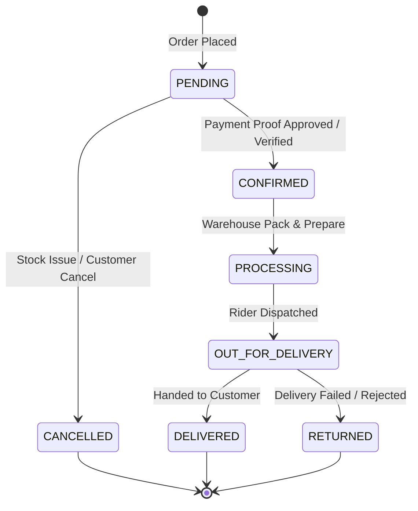

# Liquor Shop Backend — Core Features, Business Rules & Architecture Guide

This comprehensive reference manual documents the functional architecture, business logic, validation rules, state machines, and operational invariants governing the Liquor Shop Backend.

---

## 1. Fast Guest Checkout & Customer Identification

### 1.1 Zero-Friction Guest Model

- Customers never create accounts, passwords, or persistent login sessions.
- Cart sessions are initiated with `GET /api/cart` and tracked via the `X-Cart-Id` header.
- Upon checkout (`POST /api/checkout`), the customer provides `name`, `phone`, `deliveryAddress`, and optional `email` and `coordinates`.

### 1.2 Phone Number Normalization & Advisory Lock

- Phone numbers are cleansed and normalized into E.164-compatible format (e.g. `+977-9841234567` ➔ `9841234567`).
- Customer lookup and insertion uses an explicit PostgreSQL advisory lock based on the normalized phone number:
  ```sql
  SELECT pg_advisory_xact_lock(hashtext('customer:' || normalizedPhone));
  ```
- This guarantees zero duplicate customer creation races under high concurrent guest checkout spikes.
- Each guest checkout links to an existing customer record if matched by normalized phone, or atomically creates a new customer profile.

### 1.3 Order Lookup Token Security

- Checkout generates an opaque, cryptographically random, 64-character unguessable `orderLookupToken`.
- The token is hashed with SHA-256 before storage in PostgreSQL (`lookupTokenHash`).
- The plain text token is returned **only once** in the checkout response.
- Storefront clients must provide this token via the `x-order-token` header or `orderLookupToken` parameter to view order status or submit payment proofs.
- Admin APIs (`/api/admin/orders/*`, `/api/admin/customers/*`) strictly redact the lookup token and hash to preserve customer privacy.

---

## 2. Order Pricing, Minimum Subtotal & Discount Rules

### 2.1 The NPR 800 Subtotal Invariant

To prevent unprofitable micro-deliveries, the checkout engine strictly enforces:
$$\text{Eligible Subtotal} \ge \text{NPR } 800$$

- **Eligible Subtotal Calculation**: Calculated as the sum of variant selling prices minus item-level product catalog discounts.
- If $\text{Eligible Subtotal} < 800$, the checkout request immediately aborts with `400 Bad Request: ORDER_SUBTOTAL_BELOW_MINIMUM`.
- Promo codes apply **after** this condition is satisfied and do not cause checkout to fail if the post-coupon total falls below NPR 800.

### 2.2 Product Catalog Discounts

- Discounts are attached exclusively to Products (not Variants or Categories).
- Supported types: `PERCENTAGE` (0–100%) or `FIXED` amount in NPR.
- Catalog discounts apply directly to the variant selling price before cart addition.

### 2.3 Voucher Promo Codes

- Promo codes are validated via `POST /api/promo-codes/validate` and applied during checkout.
- Validation checks:
  1. `isActive === true`
  2. Current date within `startDate` and `endDate` / `expiresAt`.
  3. `usageLimit` has not been exceeded.
  4. Order subtotal meets or exceeds `minimumOrderAmount`.
- Computes discount amount capped by `maxDiscountAmount` (if configured).

---

## 3. GPS Routing & Delivery Fee Estimation

### 3.1 Kathmandu Distance & Radius Rules

- Checkout delivery fee estimation uses the customer's GPS coordinates (`latitude`, `longitude`) and store origin (`STORE_ORIGIN_LATITUDE`, `STORE_ORIGIN_LONGITUDE`).
- Maximum delivery radius is capped by `deliveryMaxDistanceKm` (default 25 km from store origin in Thamel, Kathmandu).
- If the customer's road distance exceeds the maximum radius, checkout fails with `400 OUT_OF_DELIVERY_RADIUS`.

### 3.2 Delivery Fee Calculation Formula

$$ \text{Delivery Fee} = \begin{cases}
0 & \text{if Subtotal} \ge \text{Free Threshold} \\
\text{Base Amount} + (\text{Distance Km} \times \text{Per Km Amount}) & \text{if PER\_KM mode} \\
\text{Base Amount} & \text{if FIXED mode}
\end{cases}$$

### 3.3 Free Delivery Threshold Precedence
To prevent configuration drift, the delivery free threshold respects strict precedence:
1. **Explicit Database Setting**: If an administrator sets a threshold in `StoreSettings.deliveryFeeFreeThreshold` (or sets it to 0), the database value takes precedence.
2. **Environment Variable Fallback**: If the database field is `NULL` and `hasExplicitDeliveryFeeFreeThreshold` is false, the engine falls back to `DELIVERY_FEE_FREE_THRESHOLD` from the environment.
3. **Explicit Disable**: If an administrator explicitly unsets the threshold in settings, free delivery is disabled.

---

## 4. Store Operating Hours & Business Controls

### 4.1 Weekly Schedule Evaluation
- `StoreSettings` contains an array of 7 day schedules (`MONDAY` through `SUNDAY`).
- Each day specifies:
  - `isOpen: boolean`
  - `openTime: string` (e.g. `"10:00"`)
  - `closeTime: string` (e.g. `"22:00"`)
- The server evaluates current Kathmandu time (`Asia/Kathmandu`, UTC+5:45) during checkout.
- If the store is closed on the current day or outside operating hours, checkout aborts with `400 STORE_CLOSED`.

### 4.2 Emergency Kill Switch (`isOrderingEnabled`)
- Administrators can immediately halt all new checkouts by setting `isOrderingEnabled: false` in `StoreSettings`.
- An optional `orderingMessage` (e.g. *"Online ordering temporarily paused for inventory audit"*) is displayed on the storefront.

---

## 5. Order Fulfillment Lifecycle & Tax Invoices

### 5.1 Fulfillment State Machine


### 5.2 Stock Allocation & Restoration
- When an order transitions to `PENDING`, inventory is atomically reserved (`stock` decremented, movement recorded).
- If an order is `CANCELLED` or `RETURNED`, reserved inventory is automatically restored to the variant stock and logged in the inventory movements ledger.

### 5.3 PDF Tax Invoice Generation
- Generates a print-ready binary PDF tax invoice on demand via `GET /api/admin/orders/:id/invoice`.
- Implemented with PDFKit; incorporates official store branding, customer details, line items, VAT breakdown, and payment confirmation status.

---

## 6. Offline QR Payments & Slip Verification

### 6.1 Guest Slip Upload
- For Static QR payment methods (FonePay, eSewa, Khalti), guests upload a screenshot of their transaction slip (`POST /api/orders/:orderNumber/payment-proof`).
- Accepts multipart form-data (`file`) or JSON base64.
- Max file size: 5 MB. Valid formats: JPEG, PNG, WebP. Magic byte inspection prevents executable uploads.
- Moves order payment status to `UNDER_REVIEW`.

### 6.2 Administrator Approval / Rejection
- Administrators inspect submitted proofs at `GET /api/admin/payment-submissions`.
- Approving (`POST /approve`): Moves order payment status to `PAID`, triggers order confirmation outbox notifications.
- Rejecting (`POST /reject`): Requires a mandatory rejection reason (3–500 chars), notifies customer, and keeps payment pending.

---

## 7. Media Reference Protection

The backend prevents accidental broken images across the storefront:
- `DELETE /api/admin/media` queries PostgreSQL before executing Cloudinary deletion.
- Cross-references:
  - Product cover images and gallery images (`ProductImage.publicId`, `ProductImage.imageUrl`)
  - Payment method QR assets (`PaymentMethod.qrImageUrl`)
  - Hero banners (`Banner.publicId`, `Banner.imageUrl`)
  - Showcase gallery (`Gallery.publicId`, `Gallery.imageUrl`)
  - Social media link thumbnails (`SocialMedia.publicId`, `SocialMedia.thumbnailUrl`)
- If any reference exists, the delete operation fails with `409 Conflict: ASSET_IN_USE`.

---

## 8. Transactional Notifications Outbox

1. Orders and contact inquiries write notification payloads to `NotificationOutbox` inside the database transaction.
2. The standalone background worker (`npm run notifications:worker` / `scripts/notification-worker.ts`) polls pending outbox entries.
3. Dispatches notifications with exponential backoff retry (up to 5 attempts).
4. Supported channels:
   - **Customer Email**: Order confirmed, out for delivery, delivered, cancelled receipts.
   - **Store Owner WhatsApp**: Real-time order creation alert with customer summary.
   - **Store Admin Email**: New order alert and contact inquiry alert.

$$
