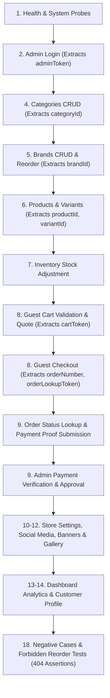

# Postman API Test Coverage & Safe Execution Guide

Comprehensive execution plan, variable chaining reference, request sequencing, and environment safety rules for testing the Liquor Shop Backend with Postman.

---

## 1. Postman Artifacts & Verification Summary

The repository provides an automated test collection and matching environment template in `docs/postman/`:

- **Collection File**: [`docs/postman/liquor-shop-backend.postman_collection.json`](file:///d:/KreativeMandu/oldLiquor/backend/docs/postman/liquor-shop-backend.postman_collection.json)
- **Environment Template**: [`docs/postman/liquor-shop-backend.postman_environment.json`](file:///d:/KreativeMandu/oldLiquor/backend/docs/postman/liquor-shop-backend.postman_environment.json)
- **OpenAPI 3.1 Spec (JSON)**: [`docs/openapi.json`](file:///d:/KreativeMandu/oldLiquor/backend/docs/openapi.json) (87 documented paths covering 148 operations)
- **OpenAPI 3.1 Spec (YAML)**: [`docs/openapi.yaml`](file:///d:/KreativeMandu/oldLiquor/backend/docs/openapi.yaml)

### 1.1 Variable Chaining Verification

Audit confirmed 100% alignment between referenced variables, environment definitions, and automated test scripts:

| Variable              | Populated By (Test Script)                            | Consumed By                                                      |
| :-------------------- | :---------------------------------------------------- | :--------------------------------------------------------------- |
| `baseUrl`             | Environment definition (`http://localhost:3000`)      | All requests (`{{baseUrl}}`)                                     |
| `adminEmail`          | Environment definition (`superadmin@liquor.test`)     | Admin Login request body                                         |
| `adminPassword`       | Environment definition (`SuperAdminSecret123!`)       | Admin Login request body                                         |
| `adminToken`          | Admin Login (`pm.environment.set("adminToken", ...)`) | All RBAC admin requests (`Authorization: Bearer {{adminToken}}`) |
| `categoryId`          | Admin Create Category                                 | Admin Update, Delete Category                                    |
| `brandId`             | Admin Create Brand                                    | Admin Update, Delete, Reorder Brands                             |
| `productId`           | Admin Create Product                                  | Admin Update Product, Create Variant, Attach Image               |
| `variantId`           | Admin Create Variant                                  | Admin Update Variant, Cart Validation, Checkout Quote            |
| `cartToken`           | Storefront Cart Validate (`X-Cart-Id`)                | Checkout Quote & Order Submission                                |
| `orderNumber`         | Storefront Checkout                                   | Order Lookup, Payment Proof Submission                           |
| `orderLookupToken`    | Storefront Checkout                                   | Order Lookup, Payment Proof Submission                           |
| `paymentSubmissionId` | Admin List / Review Payments                          | Admin Approve / Reject Payment                                   |
| `bannerId`            | Admin Create Banner                                   | Admin Update, Reorder, Delete Banner                             |

---

## 2. Environment Prerequisites & Execution Blockers

### 2.1 Testing Environments Comparison

| Mode                                  | Database                            | Prerequisites                                             | Mutating Requests Permitted?         |
| :------------------------------------ | :---------------------------------- | :-------------------------------------------------------- | :----------------------------------- |
| **Local Disposable DB** (Recommended) | Local PostgreSQL (`localhost:5432`) | `npm run db:migrate` `npm run admin:provision:initial` | **Yes** (Safe; disposable data)      |
| **In-Memory Automated Tests**         | Memory Store (No DB)                | `npm test`                                                | **Yes** (Automated; resets per test) |
| **Render Staging / Production**       | Remote Render PostgreSQL            | ⚠️ **BLOCKED**: 13 migrations pending; 0 admins           | 🛑 **READ-ONLY PROBES ONLY**         |

> [!CAUTION]
> **Do NOT run mutating Postman requests against Render**:
> The Render database currently has 13 pending migrations and 0 administrators. Admin login will fail, and checkout writes would fail schema constraints. Mutating requests against Render remain strictly blocked until migrations are authorized and applied.

---

## 3. Importing & Setting Up Postman

1. Open Postman.
2. Click **Import** (top-left).
3. Select both files:
   - `docs/postman/liquor-shop-backend.postman_collection.json`
   - `docs/postman/liquor-shop-backend.postman_environment.json`
4. In the top-right environment selector, select **Liquor Shop Backend (Local Environment)**.
5. Verify `baseUrl` is set to `http://localhost:3000`.

---

## 4. Request Classification (Read-Only vs. Mutating)

Before running requests or using the Postman Collection Runner, understand the mutation impact:

### 4.1 Read-Only Requests (Safe to Run Anytime)

- `1. Health & System`: Liveness probe (`/api/health/live`), Readiness probe (`/api/health/ready`).
- `3. Catalog Storefront`: List categories (`/api/catalog/categories`), List brands (`/api/catalog/brands`), List products (`/api/catalog/products`), View product details (`/api/catalog/products/:id`).
- `10. Public Store Settings`: View public store settings and business hours (`/api/settings`).
- `11. Public Social Media`: View active social media links (`/api/social-media`).
- `12. Public Banners & Gallery`: View active banners (`/api/banners`), View active gallery (`/api/gallery`).
- `13. Admin Dashboard Analytics`: Summary KPIs (`/api/admin/dashboard/summary`), Sales chart (`/api/admin/dashboard/sales`), Low-stock inventory (`/api/admin/dashboard/low-stock`).
- `14. Admin Customer Inspection`: List customers (`/api/admin/customers`), View customer profile (`/api/admin/customers/:id`).
- `17. Admin Audit Logs`: List audit logs (`/api/admin/audit-logs`).
- `18. Negative Cases`: Unauthorized requests (401), Forbidden reorder endpoints (404).

### 4.2 Mutating Requests (Modifies Database State)

- `2. Admin Authentication`: Admin login (updates last login timestamp).
- `4. Categories Management`: Create, Update, Delete categories.
- `5. Brands Management`: Create, Update, Delete, Reorder brands.
- `6. Products & Variants`: Create product, Add variant, Adjust inventory.
- `8. Guest Cart & Checkout`: Validate cart, Place guest order (decrements inventory, writes order & outbox records).
- `9. Payment Verification`: Submit payment proof slip, Admin Approve / Reject payment.
- `15. Contact Inquiries`: Submit public inquiry, Update inquiry status.
- `16. Media Uploads`: Upload asset to Cloudinary (creates external asset), Delete asset.

---

## 5. Recommended Execution Sequence (Happy Path)

To execute the test suite in a local environment with a prepared database, run the folders in this exact sequence:

### Detailed Sequence:

1. **Health Check**: Run `GET /api/health/live` and `GET /api/health/ready`.
2. **Authenticate**: Run `POST /api/admin/auth/login`. Postman captures `adminToken`.
3. **Provision Catalog**:
   - `POST /api/admin/categories` $\to$ captures `categoryId`.
   - `POST /api/admin/brands` $\to$ captures `brandId`.
   - `PUT /api/admin/brands/reorder` $\to$ verifies custom display ordering.
   - `POST /api/admin/products` $\to$ captures `productId`.
   - `POST /api/admin/products/{{productId}}/variants` $\to$ captures `variantId`.
4. **Stock Inventory**:
   - `POST /api/admin/inventory/{{variantId}}/adjust` $\to$ adds initial stock (e.g. +50 units).
5. **Guest Cart & Checkout**:
   - `POST /api/cart/validate` $\to$ captures `cartToken`.
   - `POST /api/checkout/quote` $\to$ validates pricing and delivery calculation.
   - `POST /api/checkout` $\to$ places order, captures `orderNumber` and `orderLookupToken`.
6. **Order Fulfillment & Proof Submission**:
   - `GET /api/orders/{{orderNumber}}` $\to$ verifies order details with lookup token.
   - `POST /api/payments/{{orderNumber}}/payment-proof` $\to$ submits bank transfer receipt reference.
   - `POST /api/admin/payments/{{paymentSubmissionId}}/approve` $\to$ approves payment.
   - `PATCH /api/admin/orders/{{orderNumber}}/status` $\to$ transitions status (`CONFIRMED`).
7. **Negative Tests (Reorder Restrictions)**:
   - Execute folder `18. Negative Cases`:
     - Assert `PUT /api/admin/categories/reorder` returns **HTTP 404 Not Found**.
     - Assert `PUT /api/admin/products/reorder` returns **HTTP 404 Not Found**.
     - Assert `PUT /api/admin/gallery/reorder` returns **HTTP 404 Not Found**.
     - Assert `PUT /api/admin/social-media/reorder` returns **HTTP 404 Not Found**.

---

## 6. Troubleshooting Common Test Failures

| Symptom / Error Code            | Root Cause                                                                        | Resolution                                                                                                                                        |
| :------------------------------ | :-------------------------------------------------------------------------------- | :------------------------------------------------------------------------------------------------------------------------------------------------ |
| `401 UNAUTHORIZED`              | `adminToken` is empty or expired (> 15 minutes).                                  | Re-run `POST /api/admin/auth/login` to refresh token.                                                                                             |
| `403 FORBIDDEN`                 | Admin user lacks required permission key.                                         | Verify admin role has required permissions (`admin.system.manage` grants full access).                                                            |
| `404 NOT_FOUND` on reorder      | Attempted to reorder Categories, Products, Gallery, or Social Media.              | Expected behavior: reorder is strictly limited to Brands and Banners.                                                                             |
| `400 VALIDATION_ERROR`          | Request payload failed Zod schema (e.g. invalid email format or negative prices). | Inspect `error.details` in response body.                                                                                                         |
| `500 CLOUDINARY_CONFIG_MISSING` | Cloudinary upload attempted without credentials configured.                       | See [`docs/cloudinary-upload-testing.md`](file:///d:/KreativeMandu/oldLiquor/backend/docs/cloudinary-upload-testing.md) for mock vs live options. |
| `503 SERVICE_UNAVAILABLE`       | Database is unreachable during readiness probe.                                   | Verify `DATABASE_URL` connectivity and PostgreSQL server status.                                                                                  |

---

## 7. Test Data Separation & Safety

- **Separate Test Recipient**: Never use real customer emails or phone numbers in checkout tests. Use dummy domains (`@example.com` or `@test.invalid`) and test phone numbers (`+9779800000000`).
- **Never Run Mutating Tests on Production**:
  - Live checkouts write to production order tables and reserve real inventory.
  - Test orders will distort analytics KPIs (gross sales, AOV, best-seller counts) on the admin dashboard.
- **Safe Reset Workflow**:
  - In local development only, clean up test records using `npm run db:migrate:dev` or drop the local test database container.
  - **NEVER run reset commands against Render.**
